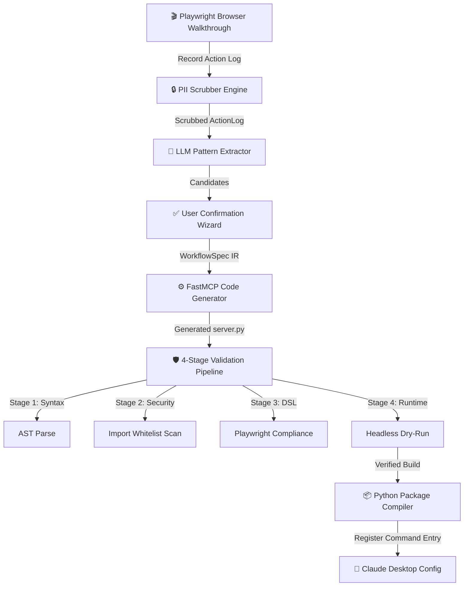

<div align="center">


# BrowserBot

**Record once. Compile forever. AI-callable in minutes.**

BrowserBot watches you use a website, then compiles that walkthrough into a secure, production-ready [Model Context Protocol](https://modelcontextprotocol.io) tool — no hand-written scripts, no exposed APIs, no cloud lock-in.

[](https://python.org)
[](https://fastapi.tiangolo.com)
[](https://playwright.dev/python)
[](https://react.dev)
[](LICENSE)

[**Quick Start**](#-quick-start) · [**Architecture**](#-architecture) · [**Security**](#-security-model) · [**Roadmap**](#-roadmap)

</div>

---

## The Problem

Most internal portals, legacy dashboards, and third-party SaaS tools have **no public API**. When AI assistants like Claude Desktop need to interact with them — looking up orders, generating reports, automating operations — developers must hand-write brittle Playwright scrapers or do it manually.

BrowserBot eliminates this entirely.

---

## How It Works

```
You demo it once  →  BrowserBot compiles it  →  Claude calls it forever
```

1. **Record** — BrowserBot launches a real Chromium window. You navigate the site normally.
2. **Scrub** — Passwords and secrets are automatically detected, replaced with tokens, and encrypted at rest. Your credentials never touch generated code.
3. **Extract** — A local/cloud LLM scans your walkthrough and identifies dynamic parameters (order IDs, search terms) and target output fields.
4. **Confirm** — You review and name the extracted parameters in a step-by-step web wizard.
5. **Compile** — BrowserBot generates a self-contained FastMCP Python server and runs a **4-stage validation pipeline**: syntax check → AST security scan → DSL compliance → headless dry-run.
6. **Install** — The validated tool is packaged and registered in `claude_desktop_config.json`. Claude Desktop picks it up on next launch.

> **Total time from demo to Claude-callable tool: under 2 minutes.**

---

## Architecture



### Session Lifecycle

BrowserBot tracks every session through a state machine backed by SQLite (WAL mode):

| State | What Happens | Output Artifact |
|---|---|---|
| `recording` | Chromium window open, user navigating | `session_ID_raw.py` |
| `recorded` | Browser closed; PII scrubber runs | `session_ID.json` + `session_ID_secrets.json` |
| `extracting` | LLM pattern extractor scans action log | `session_ID_extractor_output.json` |
| `extracted` | Parameters identified; ready for review | — |
| `confirming` | User confirms params in web UI | `session_ID_confirmed_output.json` |
| `confirmed` | WorkflowSpec IR compiled | `workflow_spec.json` |
| `generating` | Jinja2 templates rendered; validation begins | `server.py`, `mcp_tool.json` |
| `generated` | All 4 validation stages pass | `validation_report.json` |
| `packaging` | Python package structure built | `packages/execute_SITE_NAME/` |
| `packaged` | Installation integrity verified | `browserbot_package.json` |
| `registered` | Claude Desktop config updated | `claude_desktop_config.json` entry |
| `failed` | Pipeline halted at any stage | Telemetry log + failure screenshot |

---

## Security Model

Security is a first-class requirement, not an afterthought. Every generated tool must pass all four stages before it is ever written to disk.

### Stage 1 — AST Import Whitelisting

Every generated script is parsed into an Abstract Syntax Tree before execution. Only these imports are permitted:

```
✅  playwright   fastmcp   pydantic   asyncio   logging   json
❌  os   subprocess   shutil   sys   socket   (and all others)
```

```python
# ❌ REJECTED — Security violation caught at compile time
import os
import subprocess

def run():
    os.system("rm -rf /")           # SecurityError: Module 'os' is restricted
    subprocess.Popen(["curl", "…"]) # SecurityError: Module 'subprocess' is restricted

# AST Security Scan: FAILED (0/4 checks passed). Compilation aborted.
```

### Stage 2 — Zero Runtime LLM Dependency

Generated tools execute **pure deterministic Python**. Zero LLM API calls at runtime. This means:
- **100% predictable behavior** — no token variability, no hallucination risk
- **Zero marginal cost** — no API tokens consumed per tool invocation
- **Complete data privacy** — no data leaves your machine during execution

### Stage 3 — Sandboxed Intermediate Representation

All workflows pass through a constrained `WorkflowSpec` IR before code generation. This eliminates code injection vectors and arbitrary script execution entirely.

### Stage 4 — Encrypted Credential Storage

Secrets captured during recording are:
- Replaced with session-scoped tokens (`__SECRET_1__`, `__SECRET_2__`, …)
- Encrypted with Fernet (AES-128-CBC + HMAC-SHA256) using a machine-local key
- Stored in a git-ignored file (`session_ID_secrets.json`)
- Re-injected only inside worker execution memory, never into source files

### Example: Approved Tool Output

```python
# ✅ APPROVED — Generated by BrowserBot after passing all 4 validation stages
from fastmcp import FastMCP
from playwright.async_api import async_playwright
from pydantic import BaseModel, Field

mcp = FastMCP("execute_nobuycart_com")

@mcp.tool()
async def track_order(order_id: str = Field(description="Order tracking ID")) -> dict:
    """Automated headless portal order lookup for nobuycart.com."""
    async with async_playwright() as p:
        browser = await p.chromium.launch(headless=True)
        page = await browser.new_page()
        await page.goto("https://www.nobuycart.com/track")
        await page.fill('input[name="order_id"]', order_id)
        await page.click('button#track-order')
        status = await page.inner_text('.order-status')
        await browser.close()
        return {"order_id": order_id, "status": status}
```

---

## ⚡ Quick Start

### Prerequisites

| Requirement | Version |
|---|---|
| Python | 3.11+ |
| Node.js | 18+ (for frontend build) |
| [`uv`](https://docs.astral.sh/uv/) | latest |

### 1 · Clone and Install

```bash
git clone https://github.com/Sujal-Khera/Browser-Bot.git
cd Browser-Bot

# Install Python dependencies
uv sync

# Install Playwright's Chromium browser binary
uv run playwright install chromium
```

### 2 · Verify Your Environment

```bash
python -m browserbot doctor
```

This runs a full diagnostics sweep: Python version, Playwright binary, LLM reachability, port availability, and config integrity. Fix any flagged issues before proceeding.

### 3 · Launch the Web Dashboard

```bash
python -m browserbot.server
```

Open **[http://127.0.0.1:8765](http://127.0.0.1:8765)** — the step wizard guides you through the entire pipeline from recording to Claude Desktop registration.

---

## Tech Stack

| Layer | Technology | Role |
|---|---|---|
| **Core Backend** | Python 3.11+, FastAPI, Uvicorn | Orchestration REST API + SSE telemetry |
| **Browser Automation** | Playwright (Chromium) | Walkthrough capture + headless dry-runs |
| **Security Scanner** | Python `ast` module | Static import + symbol whitelisting |
| **LLM Orchestration** | LiteLLM | Local (Ollama) or cloud (Groq) pattern extraction |
| **Schema Validation** | Pydantic v2 | Strict data contracts across pipeline boundaries |
| **MCP Engine** | FastMCP Python SDK | Model Context Protocol server packaging |
| **State Database** | SQLite (WAL mode) | Session lifecycle state machine |
| **Web Dashboard** | React 19 + TypeScript + Vite + TailwindCSS v4 | Step wizard UI with live telemetry panel |
| **Credential Storage** | Fernet (AES-128-CBC + HMAC-SHA256) | Encrypted local PII/secret storage |

---

## Repository Structure

```
browserbot/
├── action_logger/          # Records user action events to structured schema
├── agents/
│   ├── code_generator/     # Renders Jinja2 templates into FastMCP server scripts
│   ├── packager/           # Wraps servers into installable Python packages
│   ├── pattern_extractor/  # LLM-driven parameter and output field detection
│   └── validator/          # Coordinates AST scanning + headless dry-run
├── cli/                    # CLI subcommands (doctor, diagnostics)
├── config/                 # Settings loader and environment management
├── models/                 # Pydantic v2 schemas (ActionLog, WorkflowSpec, StageEvent)
├── orchestrator/           # Sequential pipeline stage manager + event bus
├── recorder/               # Playwright codegen subprocess controller + PII scrubber
├── runtime/                # Resilience engine, result formatter, audit logs
├── server/                 # FastAPI routes, WebSocket manager, SQLite session store
└── templates/              # Jinja2 MCP server code generation templates

frontend/                   # React 19 + TypeScript step wizard dashboard
tests/                      # Unit, integration, and mock test suite (115/115 passing)
docs/                       # Architecture docs, design briefs, schemas
```

---

## Roadmap

### ✅ v2 — Web UI & Live Orchestration *(current)*
- [x] Interactive React step wizard (Record → Review → Generate → Validate → Package → Register)
- [x] FastAPI server with REST endpoints + WebSocket telemetry
- [x] 4-stage validation pipeline with self-healing coordinator loop
- [x] `python -m browserbot doctor` diagnostics report card
- [x] Interactive simulation demo / 60s onboarding tour
- [x] Keyboard navigation (Alt+1–9 hotkeys, `focus-visible` rings)
- [x] AST security scanner + PII scrubber with Fernet encryption
- [x] Live monospace telemetry panel + Ctrl+\ hotkey

### 🔭 v3 — Enhanced Resilience *(backlog)*
- [ ] **Multi-Agent Self-Healing** — LLM auto-patches failing locators inside the validator loop
- [ ] **Visual Parity Debugger** — Side-by-side screenshots: recorded actions vs headless validation
- [ ] **Dockerized Sandbox** — Dry-run validation inside strict Docker containers
- [ ] **Multi-threaded Ollama** — Parallel LLM calls for pattern extraction and code generation

---

## Contributing

See [CONTRIBUTING.md](CONTRIBUTING.md) for branch strategy, code style, and pull request guidelines.  
See [CODE_OF_CONDUCT.md](CODE_OF_CONDUCT.md) for community standards.  
See [SECURITY.md](SECURITY.md) for responsible disclosure policy.

---

## License

[MIT](LICENSE) — © 2026 Sujal Khera

---

<div align="center">
<sub>Built with precision. Compiled, not scripted.</sub>
</div>
