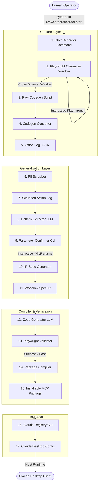

# BrowserBot Operator Handbook: User Workflow Guide

Welcome to the **BrowserBot Operator Handbook**. This document is a practical guide for users and operators who want to use BrowserBot to record web workflows, compile them into Model Context Protocol (MCP) tools, and automate tasks through Claude Desktop.

---

## 1. What BrowserBot Currently Supports

BrowserBot is a **local-first automation compiler** designed to translate a single human web browser play-through into a reusable, parameter-sensitive MCP tool.

### Supported Website Types
* **Click-and-Form-Based Web Portals:** Websites that rely on standard, predictable HTML inputs (`input`, `select`, `button`), text views, and page-load transitions. Examples include e-commerce order tracking pages, customer account portals, order placement forms, and search query pages.
* **Predictable DOM Hierarchies:** Sites that expose standard HTML elements (button roles, form labels, text matching, class list classes) where Playwright can reliably resolve elements.

### Key Operator Assumptions
1. **Linear/Deterministic Workflows:** The system is built for single-purpose workflows (e.g., "Check status of order X", "Submit form Y with values Z"). It executes actions sequentially.
2. **Pre-scrubbed Credentials:** Sensitive fields (like passwords, keys, and session pins) should be scrubbed before compilation. BrowserBot automatically detects credentials during recording and replaces them with whitelisted placeholders (e.g., `__SECRET_1__`).
3. **No Interactive Challenges:** The target workflows must not contain CAPTCHAs, Cloudflare turnstiles, bot-mitigation puzzles, or 2FA checks that require interactive human intervention during *runtime invocation* (when Claude is running the tool headlessly).

### What "Single Workflow" Means in Practice
Each compiled MCP tool represents **one specific sequence of actions** on a website. For example:
* A tool compiled from a play-through of checking an order status will *only* navigate to the tracking page, enter the order code, and read the status card.
* It **cannot** dynamically branch into catalog browsing, cart addition, or checkout unless those actions were explicitly recorded in the source play-through.
* It is generalized solely in its **inputs**: you can change the values typed into input fields (such as entering a different order tracking code), but the sequence of steps (clicks, page loads, final extraction selectors) remains identical to the demonstration.

### Multi-Site & Multi-Workflow Capabilities Today
* **Can another website work today?** **YES.** BrowserBot is site-agnostic. You can start the recorder on `https://example.com`, record steps, and compile a tool for it. The parser, generator, and validator are not hardcoded to any specific site.
* **Can another workflow work today?** **YES.** You can compile separate tools for separate workflows on the same site or different sites. Each workflow is stored as an independent package under the `packages/` directory and registered as a separate MCP tool in Claude Desktop.

---

## 2. High-Level Pipeline

The BrowserBot pipeline coordinates data conversion from initial browser interaction to registered Claude Desktop extension:



---

### Pipeline Stage Details

#### 1. Start Recorder
* **What it does:** Launches Chromium via Playwright Codegen, pre-configured with a starting URL.
* **Who starts it:** Manual (triggered by the operator).
* **Generated files:** None.
* **Expected output:** A visible Chromium browser window and the Playwright inspector utility.

#### 2. Playwright Recording (Interactive)
* **What it does:** Captures clicks, form fills, presses, and page transitions as the human clicks through the website.
* **Who starts it:** Manual (performed by the operator).
* **Generated files:** Temporary buffer file in memory.
* **Expected output:** The browser records target elements and steps.

#### 3. Close Browser & Convert
* **What it does:** Detects browser exit, writes raw Playwright script statements, and passes them to the regex parser.
* **Who starts it:** Automatic (triggered by closing the Chromium browser window).
* **Generated files:** 
  * `workflows/sessions/session_<timestamp>_raw.py` (Raw Python steps)
  * `workflows/sessions/session_<timestamp>.json` (Converted Action Log)
* **Expected output:** A parsed, structured action log mapping to the `action_log_schema.json`.

#### 4. Scrubber
* **What it does:** Scans the converted Action Log for raw password fields, tokens, keys, and PII, replacing them with unique placeholders (`__SECRET_1__`).
* **Who starts it:** Automatic (triggered as Stage 1 of the Orchestration Pipeline).
* **Generated files:** None (runs in-memory during execution).
* **Expected output:** A scrubbed Action Log with all sensitive literals redacted.

#### 5. Pattern Extractor
* **What it does:** Analyzes the scrubbed Action Log using a local LLM (or Groq fallback) to identify dynamic variables (parameters) versus static elements.
* **Who starts it:** Automatic (triggered as Stage 2 of the Orchestration Pipeline).
* **Generated files:** None (runs in-memory).
* **Expected output:** An `ExtractorOutput` JSON mapping parameters to their source step indices.

#### 6. Parameter Confirmation
* **What it does:** Prompts the user to approve, rename, mark optional, or reject the LLM's identified parameters.
* **Who starts it:** Interactive / Manual (requires operator keyboard inputs in the terminal). 
  *(Note: If `auto_confirm=True` is passed to the orchestrator, this runs automatically accepting all defaults).*
* **Generated files:** None (in-memory).
* **Expected output:** A `ConfirmedOutput` schema containing finalized input specifications.

#### 7. Workflow Spec Generation (IR Spec)
* **What it does:** Combines the scrubbed action log and confirmed parameters to generate the Intermediate Representation (IR) specification.
* **Who starts it:** Automatic (triggered as Stage 4 of the Orchestration Pipeline).
* **Generated files:** `generated_tools/<tool_name>/workflow_spec.json`
* **Expected output:** The formal JSON blueprint of the workflow.

#### 8. Code Gen & Validator
* **What it does:** Generates a Playwright execution body, runs a headless validation trial of the generated tool, and retries code generation up to 3 times on compilation or execution failure.
* **Who starts it:** Automatic (triggered as Stage 5 of the Orchestration Pipeline).
* **Generated files:**
  * `generated_tools/<tool_name>/server.py` (Compiled code file)
  * `generated_tools/<tool_name>/validation_report.json` (AST & headless execution outcome)
* **Expected output:** A valid, runnable script.

#### 9. Packager
* **What it does:** Consumes the validated files, creates the final MCP tool directory structure, and adds the required manifest, environment templates, and package lockfiles.
* **Who starts it:** Automatic (triggered as Stage 6 of the Orchestration Pipeline).
* **Generated files:**
  * `packages/<package_name>/server.py`
  * `packages/<package_name>/browserbot_package.json`
  * `packages/<package_name>/mcp_tool.json`
  * `packages/<package_name>/requirements.txt`
* **Expected output:** An installable directory package ready for Claude integration.

#### 10. Claude Desktop Registration
* **What it does:** Updates the Claude Desktop configuration file to register the packaged directory as an active MCP server.
* **Who starts it:** Manual CLI command (`python -m browserbot.runtime register`).
* **Generated files:** Overwrites `claude_desktop_config.json` with the registration details (a backup config is automatically created on first run).
* **Expected output:** Claude Desktop is aware of the new tool.

---

## 3. Creating an MCP Tool for a NEW Website

Let's walk through the exact steps to automate a new website: **`https://example.com`**.

---

### Step 1: Smoke-Test the Local Environment
* **Goal:** Verify that Playwright, Python dependencies, and the Chromium binary are installed and functional.
* **Command:**
  ```powershell
  .venv\Scripts\python.exe -m browserbot.recorder --demo --headed
  ```
* **Expected Output:** A headed Chromium browser window will briefly open, navigate to `https://example.com`, read the page title, close itself, and print:
  ```
  [PASS] Playwright smoke-test passed -- page title: 'Example Domain'
         Chromium is installed and working correctly.
  ```
* **Files Created:** None.
* **Common Mistakes:** Running without activating the virtual environment or running without installing playwright dependencies first (`playwright install chromium`).

---

### Step 2: Record the Web Workflow
* **Goal:** Record the manual execution of a login or search workflow on `https://example.com`.
* **Command:**
  ```powershell
  .venv\Scripts\python.exe -m browserbot.recorder start "https://example.com" --hint "Search for information"
  ```
* **Expected Output:** A headed Chromium window and a Playwright inspector window will open. Click elements, type values, and navigate through the target flow.
* **Files Created:** None *during* the recording.
* **Common Mistakes:** Typing a real password during recording when a mock password (like `NBC_TEST_SECRET_PASSWORD`) should be typed, or closing the Playwright inspector window instead of closing the Chromium window.

---

### Step 3: Close the Browser Window to Convert Log
* **Goal:** Stop recording and parse the playwright statements into a structured Action Log JSON.
* **Action:** Close the headed Chromium browser window.
* **Expected Output:** The terminal will display:
  ```
  [OK] Session written to: workflows/sessions/session_20260717T150935.json
  ```
* **Files Created:**
  * `workflows/sessions/session_20260717T150935_raw.py`
  * `workflows/sessions/session_20260717T150935.json`
* **Common Mistakes:** Interrupting the terminal process (`Ctrl+C`) instead of letting the script convert the browser exit cleanly.

---

### Step 4: Run the Compilation Pipeline (Interactive)
* **Goal:** Generalize the recorded log, confirm dynamic input variables, compile the tool code, validate it headlessly, and bundle the final package.
* **Command:**
  Create a compilation runner script `compile_example.py` in the root folder:
  ```python
  # compile_example.py
  from browserbot.orchestrator import OrchestrationPipeline

  # We set dry_run=False to call LiteLLM/Ollama, and dry_run=True to run offline using fill-in patterns
  pipeline = OrchestrationPipeline(dry_run=True)
  pipeline.run(
      raw_action_log_path="workflows/sessions/session_20260717T150935.json",
      output_dir="generated_tools/example_search",
      package_dir="packages/execute_example_com",
      register=False
  )
  ```
  Execute the compilation runner script:
  ```powershell
  .venv\Scripts\python.exe compile_example.py
  ```
* **Expected Output:**
  The terminal will display pipeline stage transitions, run AST security verification, execute a headless Playwright run of the compiled tool, check timing compliance, and print:
  ```
  [INFO] browserbot.orchestrator.pipeline — Loading action log
  [INFO] browserbot.orchestrator.pipeline — Scrubbing action log for PII
  [INFO] browserbot.orchestrator.pipeline — Running pattern extractor agent
  [INFO] browserbot.orchestrator.pipeline — Confirming parameters (auto-confirm mode)
  [INFO] browserbot.orchestrator.pipeline — Generating Intermediate Representation (IR) workflow spec
  [INFO] browserbot.orchestrator.pipeline — Running code generation validator pipeline coordinator
  [INFO] browserbot.orchestrator.pipeline — Compiling installable package
  [INFO] browserbot.orchestrator.pipeline — End-to-end pipeline completed successfully
  ```
* **Files Created:**
  * `generated_tools/example_search/workflow_spec.json`
  * `generated_tools/example_search/server.py`
  * `generated_tools/example_search/validation_report.json`
  * `generated_tools/example_search/pipeline_diagnostics.json`
  * `packages/execute_example_com/server.py`
  * `packages/execute_example_com/browserbot_package.json`
  * `packages/execute_example_com/mcp_tool.json`
  * `packages/execute_example_com/requirements.txt`
* **Common Mistakes:** Specifying a `package_dir` that already exists and contains files (the packager will throw an error by default unless the folder is clean).

---

### Step 5: Audit the Package for Credentials Leaks
* **Goal:** Verify that no literal passwords, API keys, or JWT tokens are present in the package files.
* **Command:**
  ```powershell
  .venv\Scripts\python.exe scripts/pii_audit.py --package packages/execute_example_com
  ```
* **Expected Output:**
  ```
  PII Audit passed successfully! No credentials or secrets found.
  ```
* **Files Created:** None.
* **Common Mistakes:** Committing custom API keys or credentials directly to source control instead of referencing environment variables.

---

### Step 6: Benchmark NFR Latency and Reliability
* **Goal:** Run consecutive headless loops of the compiled tool to measure execution speeds and verify success rates.
* **Command:**
  ```powershell
  .venv\Scripts\python.exe scripts/run_benchmark.py --package packages/execute_example_com --iterations 3
  ```
* **Expected Output:**
  The harness executes the tool 3 times headlessly, calculates minimum, maximum, mean latencies, standard deviations, and writes benchmark reports.
  ```
  [*] Starting latency & reliability benchmark for: packages\execute_example_com
  [*] Iterations: 3
  [INFO] browserbot.runtime.benchmark — Starting BrowserBot NFR benchmark
  [INFO] browserbot.runtime.benchmark — Executing benchmark iteration
  ...
  [INFO] browserbot.runtime.benchmark — Benchmark JSON report written
  [INFO] browserbot.runtime.benchmark — Benchmark Markdown report written
  ```
* **Files Created:**
  * `packages/execute_example_com/benchmark_report.json`
  * `packages/execute_example_com/benchmark_report.md`

---

### Step 7: Register with Claude Desktop
* **Goal:** Install the package into Claude Desktop's local config structure.
* **Command:**
  ```powershell
  .venv\Scripts\python.exe -m browserbot.runtime register --package packages/execute_example_com
  ```
* **Expected Output:**
  ```
  [OK] Registered package 'execute_example_com' in Claude Desktop configuration.
  ```
* **Files Created/Modified:**
  * Modifies: `C:\Users\<username>\AppData\Roaming\Claude\claude_desktop_config.json` (or equivalent `%APPDATA%\Claude\claude_desktop_config.json`)
  * Creates: `C:\Users\<username>\AppData\Roaming\Claude\claude_desktop_config.json.bak_<timestamp>` (for safety)
* **Common Mistakes:** Registering with a folder path containing spaces without quotes, or not restarting Claude Desktop after executing the registration CLI.

---

### Step 8: Invoke the Tool from Claude Desktop
* **Goal:** Instruct Claude to run the custom MCP tool to query data.
* **Action:**
  1. Restart Claude Desktop.
  2. Ask Claude:
     > "Search example.com for 'Web Automation'"
* **Expected Outcome:** Claude connects to the local FastMCP server, triggers Playwright headlessly, types "Web Automation" into the search bar, reads the results page, and provides a conversational answer.

---

## 4. Which Steps Are Automatic?

Below is a breakdown of which pipeline steps are automated by BrowserBot versus those requiring operator intervention:

| Pipeline Phase | Step Name | Mode | Who/What Triggers It? |
|---|---|---|---|
| **Capture** | Setup Environment | **Manual** | Operator runs `.venv\Scripts\python.exe` setup |
| **Capture** | Recording Actions | **Manual** | Operator interacts with Playwright Chromium |
| **Capture** | Codegen Parsing | **Automatic** | Triggered by closing Chromium window |
| **Generalization** | Credentials Redaction | **Automatic** | Orchestrator Pipeline Stage 1 (`scrubber.py`) |
| **Generalization** | Variable Extraction | **Automatic** | Orchestrator Pipeline Stage 2 (`extractor.py`) |
| **Generalization** | Parameter Confirmation | **Interactive** | Confirmer CLI (`confirmer.py`) (Manual inputs unless `auto_confirm=True`) |
| **Compilation** | IR Gen (`workflow_spec`) | **Automatic** | Orchestrator Pipeline Stage 4 (`generator.py`) |
| **Compilation** | Code Generation | **Automatic** | Orchestrator Pipeline Stage 5 (`generator.py` LLM call) |
| **Compilation** | Code Validation (AST) | **Automatic** | Orchestrator Pipeline Stage 5 (`validator.py` AST visitor) |
| **Compilation** | Playwright Validation Run | **Automatic** | Orchestrator Pipeline Stage 5 (`coordinator.py` trial execution) |
| **Compilation** | Bounded Generator Retries | **Automatic** | Pipeline Coordinator (Automatically retries on build errors) |
| **Integration** | Packaging | **Automatic** | Orchestrator Pipeline Stage 6 (`packager.py`) |
| **Integration** | Claude Registration | **Manual CLI** | Operator executes `python -m browserbot.runtime register` |
| **Runtime** | Self-Healing Loop | **Automatic / CLI** | CLI `python -m browserbot.runtime self-heal` |
| **Runtime** | Observability Benchmarks | **Manual CLI** | Operator executes `scripts/run_benchmark.py` |

---

## 5. Which Steps Require Human Decisions?

While BrowserBot automates the generation and verification loops, some steps require operator decisions to ensure correctness:

### 1. Parameter Confirmation Review
When running in interactive mode (`auto_confirm=False` in the compiler runner), the operator must review the parameters identified by the Pattern Extractor:
* **Accepting a Parameter:** Confirming the parameter (pressing `Enter` or `y`) locks it in as a dynamic tool input.
* **Renaming a Parameter:** The LLM's guessed parameter name (e.g., `value_1`) can be renamed to a clear, semantic name (e.g., `tracking_id` or `destination_zip`).
* **Rejecting a Parameter:** Rejecting a parameter (pressing `n`) flags that input value as static. For instance, if you typed a zip code that should be a parameter, but also filled out a state code that is always fixed, you can reject the state code parameter so it remains hardcoded in the generated script.
* **Optional Parameters:** The operator can mark a parameter as optional (pressing `o`), indicating that Claude does not need to supply it to run the workflow.
* **Adding Missed Parameters:** If the extractor missed a dynamic field, the operator can manually enter its name, example value, and step index to insert it into the IR spec.

### 2. Secret and Credential Handling
* **Scrubbing Validation:** Verify that sensitive fields (passwords, PINs) are properly replaced with placeholders like `__SECRET_1__` inside the scrubbed action log.
* **Runtime Secret Supply:** Claude Desktop must be configured with access to environment variables (e.g., `NBC_TEST_SECRET_PASSWORD`) so the MCP server can resolve credentials securely at execution time instead of hardcoding them.

### 3. Website-Specific Actions & Flow Boundaries
* **Start and Stop Actions:** The operator must decide exactly where the workflow starts (e.g. login landing page) and ends (e.g. status details screen).
* **Information Extraction Selection:** Make sure to select or hover over the target element you wish to extract at the end of the recording session so Playwright generates the corresponding `inner_text()` statement.

---

## 6. Generated Files Reference

During the record-compile-run lifecycle, several files are created inside the repository workspace:

| File Name | Creator Component | When Is It Created? | Folder Path | Why It Exists / Purpose |
|---|---|---|---|---|
| `session_<ts>_raw.py` | Playwright Codegen | End of recording session | `workflows/sessions/` | Raw Python steps generated by Playwright during the recording play-through. |
| `session_<ts>.json` | Codegen Converter | End of recording session | `workflows/sessions/` | Converted Action Log JSON mapping steps, selector details, and timestamps to schema. |
| `workflow_spec.json` | IR Spec Generator | Orchestrator Stage 4 | `generated_tools/<tool_name>/` | The Intermediate Representation (IR) specification that outlines parameters and actions. |
| `server.py` (intermediate) | Code Generator | Orchestrator Stage 5 | `generated_tools/<tool_name>/` | The target Playwright executable MCP tool script compiled from the spec blueprint. |
| `validation_report.json` | Validator Agent | Orchestrator Stage 5 | `generated_tools/<tool_name>/` | Verification outcomes of the AST parser, syntax validation, and dynamic execution trials. |
| `pipeline_diagnostics.json` | Orchestrator Pipeline | End of Orchestration | `generated_tools/<tool_name>/` | Log and duration statistics for each stage inside the compilation pipeline. |
| `server.py` (packaged) | Packager Agent | Orchestrator Stage 6 | `packages/<package_name>/` | The production-ready tool server containing resilience handlers and self-healing. |
| `browserbot_package.json` | Packager Agent | Orchestrator Stage 6 | `packages/<package_name>/` | Package metadata, entry-point declarations, and Claude configuration arguments. |
| `mcp_tool.json` | Packager Agent | Orchestrator Stage 6 | `packages/<package_name>/` | Schema specifying the tool's input parameters and JSON description for Claude. |
| `requirements.txt` | Packager Agent | Orchestrator Stage 6 | `packages/<package_name>/` | Python package dependency lockfile needed to execute the server script. |
| `benchmark_report.json` | Benchmark Runner | Benchmark Script execution | `packages/<package_name>/` | Raw JSON performance execution numbers (latencies list, compilation timelines). |
| `benchmark_report.md` | Benchmark Runner | Benchmark Script execution | `packages/<package_name>/` | User-friendly markdown report summarizing metric targets against actual scores. |
| `needs_healing.flag` | Packaged Server | Script failure at runtime | `packages/<package_name>/` | Empty file indicator showing that the tool failed an execution and requires healing. |

---

## 7. Commands Cheat Sheet

Below is the ordered sequence of commands an operator should run to create, verify, register, and manage a new tool:

### 1. Verify Environment
Verify the environment is set up and functional:
```powershell
.venv\Scripts\python.exe -m browserbot.recorder --demo --headed
```
* **Expected Output:** Opens page, validates browser context, and prints smoke-test completion success.

### 2. Record a Web Workflow
Launch browser recorder starting on the target site:
```powershell
.venv\Scripts\python.exe -m browserbot.recorder start "https://example.com" --hint "Perform search"
```
* **Expected Output:** Launches browser. Interact with page, close page when finished, writes `session_<ts>.json` to `workflows/sessions/`.

### 3. Compile the MCP Package
Execute your custom compilation runner (or `run_sample.py` adjusted with your target JSON path):
```powershell
.venv\Scripts\python.exe run_sample.py
```
* **Expected Output:** Triggers scrubbing, LLM extraction, code generation, execution trials, packaging, and writes files inside `packages/<package_name>`.

### 4. Audit for Secret Leaks
Scan package files to confirm all sensitive literals were redacted:
```powershell
.venv\Scripts\python.exe scripts/pii_audit.py --package packages/execute_example_com
```
* **Expected Output:** Prints verification success or reports unredacted credentials.

### 5. Benchmark Performance and NFRs
Run execution cycles to test latency limits and tool reliability:
```powershell
.venv\Scripts\python.exe scripts/run_benchmark.py --package packages/execute_example_com --iterations 3
```
* **Expected Output:** Runs tool headlessly, prints latency mean/standard deviation, and writes MD report.

### 6. Register with Claude Desktop
Register the compiled package to Claude Desktop's active servers list:
```powershell
.venv\Scripts\python.exe -m browserbot.runtime register --package packages/execute_example_com
```
* **Expected Output:** Writes config entries into Claude's JSON file.

### 7. List Registered Claude Desktop Tools
Show all BrowserBot tools currently active:
```powershell
.venv\Scripts\python.exe -m browserbot.runtime list
```
* **Expected Output:**
  ```
  Registered MCP servers in Claude Desktop:
    • execute_example_com
  ```

### 8. Manually Trigger Self-Healing
Force rebuild a package if elements have changed:
```powershell
.venv\Scripts\python.exe -m browserbot.runtime self-heal --package packages/execute_example_com --force
```
* **Expected Output:** Re-evaluates metadata, pulls source action logs, recompiles files, and updates registration.

### 9. Unregister a Tool
Remove a registered server from Claude Desktop:
```powershell
.venv\Scripts\python.exe -m browserbot.runtime unregister --tool execute_example_com
```
* **Expected Output:** Modifies Claude configuration to remove the server node.

---

## 8. Creating Multiple Tools

An operator can generate and host multiple distinct browser tools concurrently.

### What is Reused
* **Core Virtual Environment (`.venv`):** Python library dependencies (Playwright, FastMCP, LiteLLM) are installed once in the workspace.
* **The `browserbot` Package:** All scripts, templates (`server.py.j2`), validation logic, and registry tools are shared.
* **LLM Local Models:** Ollama models pulled on disk (e.g., `qwen2.5-coder`) are shared.

### What is Regenerated
* **The Play-through Script (`_raw.py` and `.json`):** Each workflow requires its own browser play-through.
* **Package Directory:** Each tool gets its own directory under `packages/` (e.g. `packages/execute_order_tracker`, `packages/execute_invoice_downloader`).

### How Packages Are Organized on Disk
```
packages/
  ├── execute_order_tracker/
  │     ├── server.py
  │     ├── browserbot_package.json
  │     ├── mcp_tool.json
  │     └── requirements.txt
  ├── execute_invoice_downloader/
  │     ├── server.py
  │     ├── browserbot_package.json
  │     ├── mcp_tool.json
  │     └── requirements.txt
  └── execute_hr_portal/
        ├── server.py
        ├── browserbot_package.json
        ├── mcp_tool.json
        └── requirements.txt
```

### Potential Interferences
* **No Process Interference:** Each registered MCP server runs as a separate subprocess initiated by Claude Desktop. They run in isolation and do not share runtime memory.
* **Browser Profile Isolation:** Playwright launches fresh, stateless browser contexts for every invocation, ensuring cookies and storage variables do not leak between different tools.
* **Port / Network conflicts:** All tool servers run over standard input/output (STDIO) transport. They do not open local network ports, avoiding port collision risks.

---

## 9. Demonstrating BrowserBot

To showcase BrowserBot to stakeholders, follow this structured end-to-end demonstration flow:

### 1. Fresh Recording
* Open a terminal window.
* Run the recorder:
  ```powershell
  .venv\Scripts\python.exe -m browserbot.recorder start "https://nobuycart.com/tracking/" --hint "Check order status"
  ```
* In the Chromium browser window, type the mock order code: `NBC-2026-E3ZXJC` into the order input field.
* Click the **"Show timeline"** button.
* Hover over the order status card to reveal the tracking state.
* Close the browser window to trigger the conversion.

### 2. Compilation and Generation
* Run the compilation pipeline to build the package:
  ```powershell
  .venv\Scripts\python.exe run_sample.py
  ```
* Show the terminal output validating AST security rules and executing validation trials.

### 3. Claude Registration
* Register the generated tool:
  ```powershell
  .venv\Scripts\python.exe -m browserbot.runtime register --package packages/execute_nobuycart_com
  ```

### 4. Live Invocation via Claude Desktop
* Restart the Claude Desktop app.
* Start a new chat session.
* Prompt Claude:
  > "Claude, check the status of my order NBC-2026-E3ZXJC using my order tracker tool."
* Point out that Claude connects to the local MCP server and launches Chromium headlessly.
* Claude reads the status card and returns the formatted response:
  > "I've checked the status of your order NBC-2026-E3ZXJC. It is currently in **In Transit** status, shipping from warehouse location..."

---

## 10. Current Limitations

* **Manual Browser Recording:** Recording requires an operator to click through the workflow manually inside Chromium.
* **Interactive CLI Confirmation:** Custom parameter naming and optional flag overrides require keyboard inputs in the terminal unless default auto-confirmation is enabled.
* **No CAPTCHA Bypass:** The headless browser runtime cannot bypass CAPTCHAs, bot-protection hurdles, or interactive Cloudflare check pages.
* **No Runtime 2FA Support:** Workflows requiring interactive multi-factor login loops (like OTP codes sent via SMS) during execution cannot run autonomously.
* **Single-Path Sequential Execution:** The generated code strictly follows the linear path recorded in the demonstration. It cannot execute conditional branching logic based on arbitrary page state changes (e.g. "if field A is present click B, otherwise click C").
* **Headless Resolution Issues:** Some responsive sites change their layout or hide elements when rendered in Playwright's default headless viewport dimensions.

---

## 11. Future Generalization (Conceptual)

To generalize BrowserBot into an enterprise product capable of generating tools for arbitrary websites, several components would need to evolve conceptually:

```
[Playwright Event Logs] 
         │
         ▼
[Visual Layout Analyzer (VLM)] ──► [Dynamic State Graph] ──► [Adaptive Element Locator] ──► [Resilient Runtime]
         ▲                                                                                          │
         └─────────────────────── [Self-Correcting Heuristics] ◄────────────────────────────────────┘
```

* **Visual LLM Agents (VLMs):** Instead of relying on regex-based code templates, code generation could utilize visual layout models to identify elements by spatial arrangement and visual cues rather than raw DOM selectors.
* **Dynamic Branching Graphs:** Upgrading the Intermediate Representation (IR Spec) from a linear list of steps to a state-graph representation. This would support complex workflows with dynamic decisions (e.g. conditional branches for login loops, popups, or error screens).
* **Automatic Cookie and State Synchronization:** A secure state manager to share authenticated browser cookies and local storage tokens from the user's primary browser to the headless Playwright instance. This would allow automated workflows without requiring manual credentials inputs.
* **Distributed Headless Farm:** Offloading headless tool runs from the operator's local machine to a secure, containerized serverless environment to improve execution speed and scalability.

---

## 12. FAQ

#### Can I automate another website?
**Yes.** BrowserBot is site-agnostic. You can start the browser recorder on any URL, record actions, and run compilation.

#### Do I need to edit code to create a new tool?
**No.** All steps (redaction, extraction, code generation, verification, packaging, registration) are handled automatically by the orchestrator and CLI utilities. You only need to run the commands in order.

#### Can I reuse one recording for multiple tools?
**No.** A recording represents a specific workflow on a site. To create a different tool (e.g. an "Invoice Downloader" vs. "Profile Updater"), you must record a new play-through.

#### Can I generate multiple MCP tools?
**Yes.** Each compiled tool is bundled into a distinct directory under `packages/` and registered with Claude Desktop. They run independently.

#### Can I delete raw recordings after packaging?
**Yes.** Once the final package folder is compiled and registered under `packages/`, you can delete raw files under `workflows/sessions/`. *(Note: Deleting these files will prevent you from running the `self-heal` CLI on that package, as it requires the source session log to recompile).*

#### Can I regenerate only the server file?
**Yes.** You can re-run the code generation phase from the compiled `workflow_spec.json` without recording a new browser session.

#### Do I need to rerun validation when upgrading a tool?
**Yes.** Validation checks ensure that modified code is structurally valid and can execute successfully before installation.

#### Can I package twice?
**Yes.** You can run the packaging script multiple times. The packager will write fresh bundle files to the destination package folder.

#### How do I update an existing tool?
To update a tool (e.g. if the site UI changed):
1. Record a new play-through.
2. Compile and package the tool using the same package directory name.
3. Re-register the tool with Claude Desktop.

#### Can two generated tools coexist in Claude Desktop?
**Yes.** Claude Desktop can run multiple MCP servers simultaneously. They are registered under unique names and do not interfere with each other.
